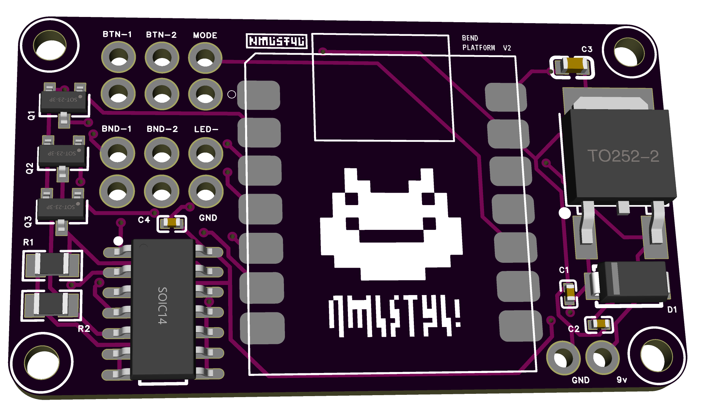

# Bend Platform v2



Adds footswitches to a guitar fuzz/distortion pedal that open and close circuit
"bends" in a musical way. A Seeeduino XIAO (SAMD21) on the **Bend Platform v2** PCB
drives three **AO3400A** MOSFETs. One interrupts the pedal's main LED, which is used as
the mode indicator. The other two drive a **CD4066** analog switch that toggles or
stutters two circuit-bend points on the pedal.

See [`HARDWARE-V2-NOTES.md`](HARDWARE-V2-NOTES.md) for the v2 board review notes: bend
polarity, CD4066 limits, and power cautions.

## Prototype platform

Prototyped against a **LANDTONE DIY "Build Your Own Fuzz Pedal" kit** — a through-hole,
true-bypass fuzz/distortion in a 1590B enclosure (Volume + Drive controls, 9 V).
See [`docs/parts-data/landtone-kit/`](docs/parts-data/landtone-kit/) for kit details and
where the controller taps in; product listing:
[Amazon B06XQL49G8](https://www.amazon.com/dp/B06XQL49G8).

## Controls

- **MODE button** — cycles through the four bend modes (1 → 2 → 3 → 4 →) and blinks the
  pedal's main LED the mode number (1–4) so you can tell which mode you're in.
- **BTN-1 / BTN-2** — work the two bends according to the current mode.

### Modes

| # | Mode              | Bend button behavior                         |
|---|-------------------|----------------------------------------------|
| 1 | momentary         | bend engaged while the button is held        |
| 2 | momentary tremolo | bend stutters while the button is held       |
| 3 | latching          | press toggles the bend on/off                |
| 4 | latching tremolo  | press toggles a stuttering bend on/off       |

## Pin map (Seeeduino XIAO SAMD21, Bend Platform v2 PCB)

| Signal            | Pin | Drives / net                          | Notes                                  |
|-------------------|-----|---------------------------------------|----------------------------------------|
| MODE button       | D9  | MODE                                  | `INPUT_PULLUP`, to GND                  |
| BTN-1             | D2  | BTN-1                                 | `INPUT_PULLUP`, to GND                  |
| BTN-2             | D3  | BTN-2                                 | `INPUT_PULLUP`, to GND                  |
| Q1 gate           | D1  | LED- pad (Q1 drain; source on GND)    | interrupts the pedal's main LED         |
| Q3 gate           | D5  | CD4066 CONTROL A → BND-1 / BND-1-OUT  | bend 1 (BTN-1); **active LOW**          |
| Q2 gate           | D4  | CD4066 CONTROL B → BND-2 / BND-2-OUT  | bend 2 (BTN-2); **active LOW**          |

The gates are driven directly, with no series resistors and no external pull-downs.
The firmware sets the gate pins first thing in `setup()`. The buttons pull to GND.

## Hardware wiring notes

### Bends (CD4066)

Each bend is a CD4066 switch. Q2 and Q3 pull its control pin low against a 10k pull-up
to 9 V, so the logic is inverted: **gate HIGH = bend open, gate LOW = bend closed**.
The firmware handles this with `BEND_ON` / `BEND_OFF`. Set `#define BOARD_V2 0` to run
on the old v1 2N7000 wiring.

From the TI CD4066B datasheet:

- The pedal being bent **must share ground** with the platform (the GND pad).
- Bend-point signals must stay **between 0 V and 9 V** relative to that ground.
- At most **10 mA** through each switch. On-resistance is about 180–400 Ω at 9 V.

### LED interrupt (Q1)

Q1 is an N-channel MOSFET used as a low-side switch: drain → the **LED-** pad, source →
the platform's GND. Keep it **in series with** the pedal's own LED-ground switch (the
3PDT lug), not in place of it, so the pedal still controls on/off and Q1 only blinks it:
lift the ground wire from the 3PDT's LED common lug and run that lug to **LED-** instead.
The LED's return path is then LED cathode → 3PDT → LED- → Q1 → GND, which relies on the
pedal sharing ground with the platform (it must anyway, for the bends).

### Power

9 V battery → SS14 reverse-polarity diode → L78M05 → the XIAO's 5V pin.

- A reversed battery is blocked by the diode.
- The regulator drops out once the battery sags to about 7.4 V.
- **Don't plug in USB while the battery is connected.** USB would back-feed into the
  regulator output.

## Serial log

Connect at **9600 baud** for an event log of what each press does, e.g.:

```
MODE -> mode 3 (latching)
BTN-1 -> bend1 latched ON
```

Set `#define LOG 0` to compile it out. `#define T1_TEST 1` swaps in a standalone
slow on/off test of the Q1 LED interrupt for bench debugging.

## Build

Arduino IDE or `arduino-cli`, board **Seeeduino XIAO (SAMD21)**:

```
arduino-cli compile --fqbn Seeeduino:samd:seeed_XIAO_m0 .
arduino-cli upload  --fqbn Seeeduino:samd:seeed_XIAO_m0 -p <port> .
```

If upload fails to find the board, double-tap RESET to enter the bootloader, then
reselect the port.

## Repo contents

- `bend-platform-v2.ino` — the firmware (single file)
- `HARDWARE-V2-NOTES.md` — Bend Platform v2 board review and firmware notes
- `docs/layouts-schematics/prototype/` — v1 prototype schematics (PDF) and EasyEDA
  project (`bend Platform.eprj`). The v2 project (`bend Platform-v2.eprj`) lives in
  the EasyEDA Pro projects folder.
- `docs/drill-template/` — enclosure / faceplate layout SVGs
- `docs/bend-locations/` — annotated photos of the bend points on the fuzz
- `docs/parts-data/chips/` — CD4066B, XIAO and op-amp datasheets
- `docs/parts-data/transistors/` — AO3400A and 2N7000 datasheets / pinouts
- `docs/parts-data/landtone-kit/` — notes on the LANDTONE fuzz kit used to prototype
- `docs/prototype-wiring/` — build photos
- `docs/art/` — sticker artwork
